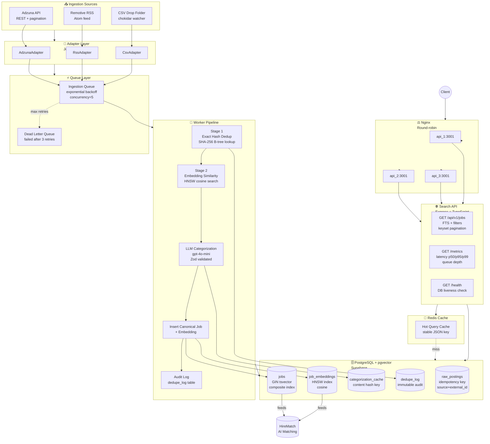
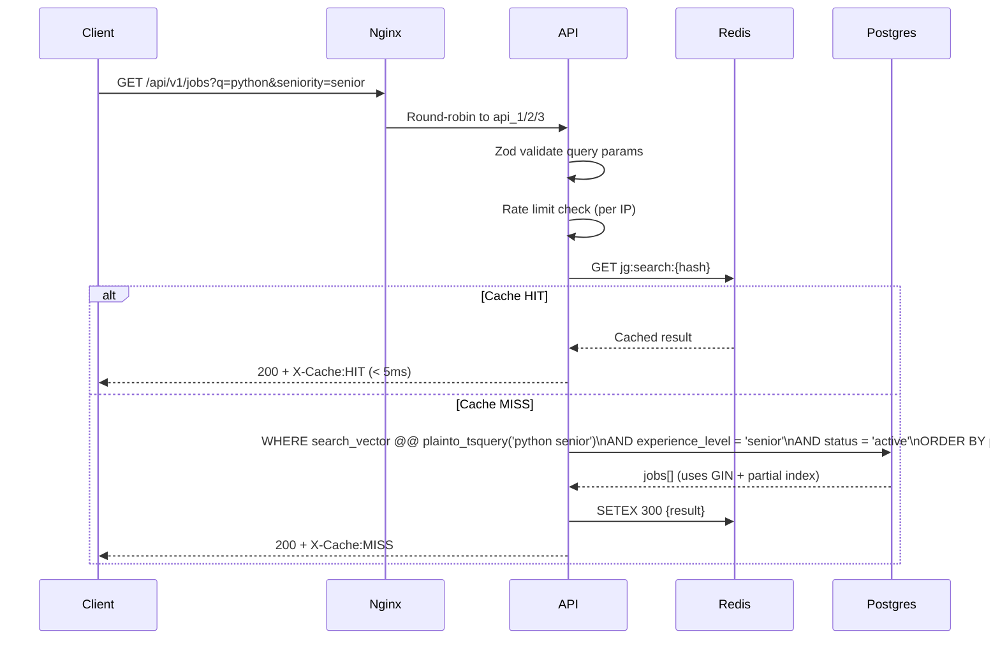
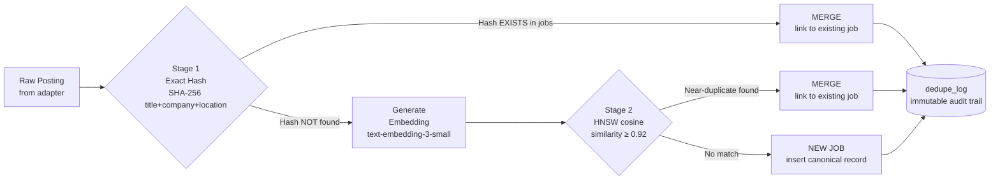

# JobGraph 🔍

> **AI-powered job ingestion, deduplication, categorization, and search platform.**
> Feeds directly into [HireMatch](https://github.com/AbhishekKothari511/hirematch) — the semantic job-matching system built on the same Supabase PostgreSQL schema.

[](https://www.typescriptlang.org/)
[](https://nodejs.org/)
[](https://github.com/pgvector/pgvector)
[](https://bullmq.io/)

---

## What it does

JobGraph ingests job postings from multiple sources (Adzuna API, RSS feeds, CSV files), deduplicates them using a two-stage pipeline (exact hash + vector similarity), categorizes them with an LLM, and serves them via a fast, cached REST API — all at scale.

---

## Architecture



---

## Request Flow — Search API



---

## Deduplication Pipeline



---

## Tech Stack

| Layer | Technology | Why |
|-------|-----------|-----|
| **Language** | TypeScript (strict) | End-to-end type safety; shared types via monorepo |
| **Monorepo** | npm workspaces | Zero-config package linking, no build tooling overhead |
| **Validation** | Zod | Runtime schema enforcement at every boundary |
| **Database** | Supabase PostgreSQL 15 | Managed Postgres with pgvector, RLS, and connection pooling |
| **Vector Search** | pgvector HNSW (cosine) | No training step; better recall than IVFFlat; incremental inserts |
| **Full-text Search** | Postgres GIN on `tsvector` | 2-3× faster than GiST for `@@` queries; standard recommendation |
| **Queue** | BullMQ + Redis | Exactly-once semantics; exponential backoff; DLQ; concurrency control |
| **LLM** | OpenAI gpt-4o-mini | Structured JSON output; cheapest model with good classification accuracy |
| **Embeddings** | text-embedding-3-small | 1536-dim; compatible with HireMatch's existing embeddings |
| **Logging** | pino | Fastest Node.js JSON logger; zero-overhead on disabled log levels |
| **API** | Express + TypeScript | Simple, battle-tested; Zod middleware for request validation |
| **Caching** | Redis (SETEX + SCAN) | Hot query cache with TTL; SCAN-based pattern invalidation (no KEYS blocking) |
| **Load Balancing** | Nginx (round-robin) | Stateless API → round-robin is optimal; keepalive pool reduces handshake overhead |
| **Benchmarking** | k6 | JavaScript-native; CI-friendly; VU-based load model |
| **Containers** | Docker + docker-compose | Multi-stage builds (no dev tools in production images); non-root user |

---

## Project Structure

```
jobgraph/
├── packages/
│   └── shared/                   # Shared Zod schemas + TypeScript types
│       └── src/
│           ├── types/index.ts    # Domain types (Job, RawPosting, etc.)
│           ├── schemas/          # Zod validators for all boundaries
│           └── utils/normalize.ts # Normalization + hashing utilities
│
├── apps/
│   ├── ingestion/                # Source adapter runner
│   │   └── src/
│   │       ├── adapters/
│   │       │   ├── interface.ts      # JobAdapter interface (AsyncGenerator)
│   │       │   ├── adzunaAdapter.ts  # Adzuna REST API
│   │       │   ├── rssAdapter.ts     # Any RSS/Atom feed
│   │       │   └── csvAdapter.ts     # Drop-folder CSV watcher
│   │       └── services/
│   │           └── supabaseService.ts
│   │
│   ├── worker/                   # BullMQ job processor
│   │   └── src/
│   │       ├── queues/ingestionQueue.ts     # Queue + DLQ definitions
│   │       ├── processors/ingestionProcessor.ts  # Main pipeline
│   │       └── services/
│   │           ├── dedupeService.ts          # 2-stage dedup
│   │           ├── embeddingService.ts       # OpenAI embeddings
│   │           └── categorizationService.ts  # LLM + cache
│   │
│   └── api/                      # Search API
│       └── src/
│           ├── routes/
│           │   ├── jobs.ts       # GET /api/v1/jobs (search + pagination)
│           │   ├── health.ts     # GET /health
│           │   └── metrics.ts    # GET /metrics (Prometheus-style)
│           └── services/
│               ├── searchService.ts  # Keyset pagination + FTS
│               └── cacheService.ts   # Redis TTL cache
│
├── supabase/migrations/          # SQL migrations (run in order)
│   ├── 001 enable_extensions     # pgvector, pg_trgm, uuid-ossp
│   ├── 002 create_tables         # raw_postings, jobs, job_embeddings, dedupe_log, cache
│   ├── 003 create_indexes        # GIN, HNSW, composite, trigram, partial
│   ├── 004 rls_policies          # Public read active jobs; internal tables blocked
│   └── 005 near_duplicate_search # find_near_duplicates() SQL function
│
├── nginx/nginx.conf              # Load balancer (round-robin, 3 api instances)
├── bench/k6/                     # k6 benchmark scripts (baseline, indexed, cached)
├── bench/RESULTS.md              # Benchmark results table
├── docker-compose.yml            # Local dev: postgres, redis, worker, api×3, nginx
└── DECISIONS.md                  # 9 ADRs with context/options/decision/consequences
```

---

## Quickstart (Local)

### Prerequisites
- Node.js 20+
- Docker Desktop
- A Supabase project (free at supabase.com) **OR** local Postgres with pgvector

### 1. Clone and install
```bash
git clone https://github.com/AbhishekKothari511/jobgraph
cd jobgraph
npm install
```

### 2. Configure environment
```bash
cp .env.example .env
# Fill in:
#   SUPABASE_URL, SUPABASE_SERVICE_ROLE_KEY
#   ADZUNA_APP_ID, ADZUNA_APP_KEY  (free at developer.adzuna.com)
#   OPENAI_API_KEY
```

### 3. Run migrations
```bash
# In your Supabase SQL editor, run migrations in order:
# supabase/migrations/20260101000001_enable_extensions.sql
# ...through...
# supabase/migrations/20260101000005_near_duplicate_search.sql
```

### 4. Start the full stack
```bash
docker-compose up -d
# Starts: postgres, redis, worker, api×3, nginx
```

### 5. Test the API
```bash
# Search jobs
curl "http://localhost:8080/api/v1/jobs?q=python&seniority=senior&remote=true&limit=10"

# Health check
curl "http://localhost:8080/health"

# Metrics
curl "http://localhost:8080/metrics"
```

### 6. Run Phase 1 offline tests
```bash
npm run test:phase1 --workspace=scripts
# Expected: 29/29 passed
```

---

## Benchmarks

Run the k6 scripts and fill in [`bench/RESULTS.md`](bench/RESULTS.md):

```bash
# Install k6: https://k6.io/docs/get-started/installation/
k6 run bench/k6/baseline.js --env BASE_URL=http://localhost:8080
k6 run bench/k6/indexed.js  --env BASE_URL=http://localhost:8080
k6 run bench/k6/cached.js   --env BASE_URL=http://localhost:8080
```

Expected improvement: **Baseline → Indexed: ~10-20× faster p95. Indexed → Cached: ~10-50× faster p95.**

---

## HireMatch Integration

JobGraph feeds directly into [HireMatch](https://github.com/AbhishekKothari511/hirematch) because they share the same Supabase project and the same `jobs` + `job_embeddings` table schema.

```
JobGraph worker  →  writes to jobs + job_embeddings  →  HireMatch /matches reads them
```

No ETL, no sync layer — the same database row created by JobGraph is immediately queryable by HireMatch's hybrid search function.

---

## Design Decisions

See [DECISIONS.md](DECISIONS.md) for 9 full ADRs covering:

| ADR | Decision |
|-----|----------|
| 001 | npm Workspaces over Turborepo/Nx |
| 002 | AsyncGenerator adapter interface over callbacks |
| 003 | (source_name, external_id) composite idempotency key |
| 004 | HireMatch schema compatibility — shared Supabase project |
| 005 | Adzuna + Remotive RSS + CSV drop folder |
| 006 | Two-stage dedup: exact hash → embedding similarity |
| 007 | SHA-256 content hash for LLM categorization cache |
| 008 | GIN over GiST for tsvector full-text index |
| 009 | Keyset pagination over offset pagination |

---

## Related Projects

- **[HireMatch](https://github.com/AbhishekKothari511/hirematch)** — AI semantic job-matching platform that uses JobGraph's canonical jobs table for resume-to-job matching with LLM explanations.
